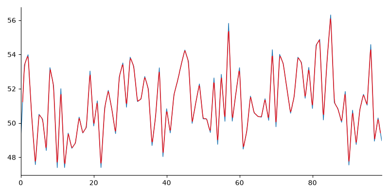

# Graph Extractor

A tool for extracting time series data from images of graphs.

## Problem

<!-- TODO -->

## Pipeline

### Step 2: Synthetic charts with ground truth

`src/generate_samples.py` draws 15 line charts (trend, seasonal, random walk,
trend + seasonal) with different colours, line widths, grids and image sizes.
For each `samples/chart_XX.png` it also saves the exact data that was plotted
(`chart_XX_truth.csv`) and the axis limits and plot-area box
(`chart_XX_meta.json`). Seeds are fixed, so every run produces the same
charts. Having the true data lets us measure how accurate each step is.

The extraction code never reads the meta files. Only the tests use them, to
check the results.

### Step 3A: Find the plot area

`detect_plot_area` in `src/extract.py` looks for the axis lines. It keeps only
dark pixels, then uses morphological opening with long, thin kernels so that
only long straight lines survive. Text, ticks and the data line are too short
and disappear. The x axis gives the bottom and right edges; the y axis gives
the left and top edges.

### Step 3B: Isolate the line

`extract_line_pixels` looks just inside the plot area (3 px in, to stay clear
of the axes). It picks out coloured pixels using HSV saturation, which skips
the white background, grey grid and black axes. For each pixel column it takes
the middle (median) of the line's pixels, and fills empty columns by
interpolation.

Black or grey lines have no colour, so if fewer than 100 coloured pixels are
found it switches to dark pixels instead (grayscale below 80). It reports which
mode it used: `"color"` or `"dark"`.

### Step 3C: Convert pixels to values

`calibrate` in `src/calibrate.py` maps pixels to data values with a straight
line through two reference points per axis: left edge to `xmin`, right edge to
`xmax`, bottom edge to `ymin`, top edge to `ymax`. Pixel rows count downward
but values go up, so the y mapping is flipped. Using bottom to `ymin` and top
to `ymax` as the references handles this automatically.

For now the axis limits come from the meta files. Reading them from the tick
labels is a later step.

### Step 4: Full pipeline and evaluation

`extract_series` in `src/pipeline.py` runs Steps 3A to 3C on one image. Give it
the axis limits to get data values, or leave them out to get pixel positions.
It also returns the mode (`color` or `dark`) and the detected box. It never
reads the meta files. The same thing is available from the command line:

```
python -m src.pipeline chart.png --xmin 0 --xmax 99 --ymin 40 --ymax 60 --out out.csv
```

`src/evaluate.py` runs the pipeline on every sample chart and compares the
result with the true data (see Results). It is the only code that reads the
meta files, and only to get the axis limits. `src/overlay.py` draws the
extracted line in red on top of each chart so you can check it by eye; the
images are in `docs/overlays/`.

### Step 5: Forecasting

`src/forecast.py` has three simple models. Each one takes the training values
and a horizon `h` and returns `h` predictions:

- **naive**: repeats the last value. The baseline the others must beat.
- **ets**: Holt's exponential smoothing with an additive trend and no
  seasonality.
- **arima**: ARIMA(1,1,1).

If a statsmodels model fails to fit, gives a convergence warning or returns
NaN, it falls back to the naive forecast and prints a warning, so one bad fit
does not stop a run.

**Why resample first.** The extracted series has one point per pixel column,
so its length depends on the image width (430 to 1,110 points on the samples), and
many of those points are just interpolated between neighbours.
`resample_series` puts every chart onto the same number of evenly spaced
points (100 by default). The models assume equal steps, and a fixed length
makes results comparable across charts.

### Step 6: Rolling validation

`src/validate.py` tests each model the way it would be used: forecasting a
future it has not seen.

- **Expanding window.** At each cut point the model trains on everything
  before it and forecasts the next `h = 10` points. The first cut is after
  `min_train = 30` points, then it moves forward `step = 2` points at a time,
  so the training window keeps growing.
- **Error as a % of the training range.** Each absolute error is divided by
  the range (max - min) of that window's training data. This puts charts with
  different scales on the same footing.
- **Results per step ahead.** `summarize` reports the mean error, the error at
  each of the 10 steps ahead, and the 90th percentile.

**Windows overlap, so they are not independent.** With `step = 2` and
`h = 10`, neighbouring windows share most of their forecast points and almost
all of their training data. The number of windows overstates how much
evidence there is, so small differences between models should not be read as
meaningful.

## Install

<!-- TODO -->

## Usage

<!-- TODO -->

## Results

**These results are on the 15 synthetic charts in `samples/`, not on real
charts.** The synthetic charts are clean, with one line and no frame, legend
or labels inside the plot. The axis limits are taken from the meta files, not
read from the image. Expect real charts to do worse.

Errors are a percentage of the y-axis range. Regenerate with
`python -m src.evaluate`, which saves `docs/extraction_results.md`.

| chart | mode | RMSE% | MAE% |
|---|---|---:|---:|
| chart_01 | color | 4.87 | 3.70 |
| chart_02 | color | 2.32 | 1.82 |
| chart_03 | color | 1.03 | 0.79 |
| chart_04 | color | 0.76 | 0.60 |
| chart_05 | color | 0.77 | 0.60 |
| chart_06 | dark | 1.70 | 1.33 |
| chart_07 | color | 1.81 | 1.39 |
| chart_08 | color | 0.51 | 0.41 |
| chart_09 | color | 2.03 | 1.47 |
| chart_10 | color | 2.56 | 2.03 |
| chart_11 | color | 1.75 | 1.38 |
| chart_12 | color | 1.17 | 0.93 |
| chart_13 | color | 1.42 | 1.05 |
| chart_14 | dark | 1.71 | 1.28 |
| chart_15 | color | 1.73 | 1.38 |
| **mean** | | **1.74** | **1.34** |
| **max** | | **4.87** | **3.70** |

The worst case, `chart_01`, with the extracted line in red over the original
(blue). Most of the line matches; the sharpest spikes show blue tips where the
extraction cuts them short.



## Limitations

- **Easier than real charts.** The sample charts hide their top and right
  borders, and there is nothing else inside the plot area. Real charts often
  have a full frame, legends, labels and several lines, so finding the plot
  area there is harder.
- **The dark fallback picks up anything dark.** Dark text, markers or a legend
  inside the plot area get mixed in with the line and pull the result off.
- **Black or grey lines rely on the fallback.** They only work through the
  dark-pixel mode. Mid-grey lines (lighter than grayscale 80) match neither
  mode and fail.
- **Sharp spikes get flattened.** Taking one value per pixel column cuts the
  tips off narrow peaks, and the first and last few pixels next to the axes
  are not measured. Noisy charts with steep jumps have the largest error.
- **One line per chart.** With several lines, the column median falls between
  them.
