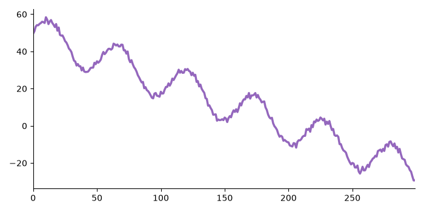
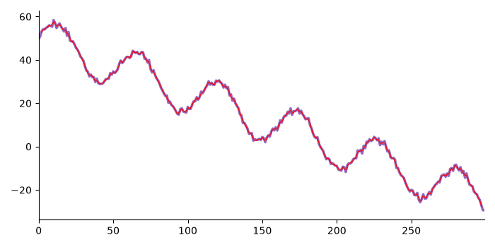
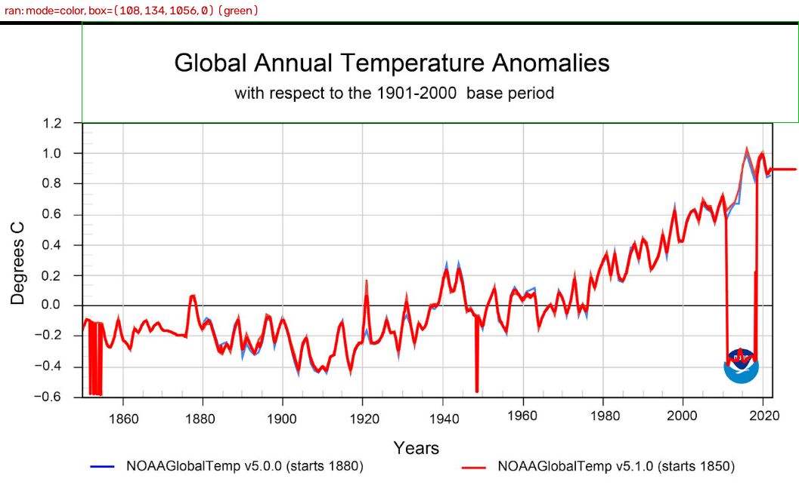

# Time Series Graph Extraction & Forecast Risk Tool

**Upload a picture of a line chart. The tool reads the data from the pixels,
forecasts the next points, and tells you how likely each forecast is to be wrong.**

- Demo video: [LINK]
- Repo: [GITHUB LINK]
- Built for the ODYCEO Annual Project Development assessment (Option 1).

## 1. In 30 seconds

1. **Image -> data:** classical computer vision (OpenCV) finds the plot area and traces the line.
2. **Data -> forecast:** three simple models (naive, ETS, ARIMA) predict the next 10 points.
3. **Forecast -> risk:** rolling forecast validation pretends to be at earlier times, forecasts, and
   checks what really happened. The share of misses is the estimated **probability of being wrong**,
   per forecast step, with a 95% confidence interval.

Upload only: no numbers need to be typed. Everything else is optional.

## 2. Requirements checklist

| Requirement | Where |
|---|---|
| Upload an image of a time series graph | Streamlit app: `app.py` |
| Computer vision extracts the data | `src/extract.py`, `src/pipeline.py` |
| Rolling forecast validation, mean error baseline | `src/validate.py` |
| Probability that the forecast is wrong | `src/risk.py` |
| Git repository | [GITHUB LINK] |
| Technical documentation | this README |
| Short video demonstration | [VIDEO LINK] |
| Sample test images | `samples/` (synthetic), `samples/real/`, `samples/real_heldout/` |
| Ground truth for the samples | `samples/chart_XX_truth.csv` |
| Evaluation metrics from real runs | section 6 and `docs/` |

## 3. Quick start (Windows PowerShell)

Requires Python 3.13 (what the project was built and tested on).

```powershell
git clone [GITHUB LINK]
cd Graph-extractor
python -m venv .venv
.venv\Scripts\Activate.ps1
pip install -r requirements.txt
streamlit run app.py
```

Open the Local URL that Streamlit prints in the terminal (usually http://localhost:8501; if the port is busy, run streamlit run app.py --server.port 8502 instead).
Then upload samples/chart_04.png and read the results.
If a chart has several lines, choose the colour in the sidebar.

Other commands:
- `pytest` runs all tests.
- `python -m src.evaluate` rebuilds the accuracy table.
- `python -m src.pipeline samples/chart_04.png --out out.csv` runs extraction from the command line.

### Optional settings

None of these are required: the default is upload only.

| Option (app / command line) | What it does | When to use it |
|---|---|---|
| Line to extract (sidebar) / `--color N` | Extracts only one line colour (N = number from `--list-colors`, 1 = largest) | The chart has several lines |
| `--list-colors` (command line only) | Lists the line colours found in the plot area and exits | To find N for `--color` |
| Advanced > Plot box > Manual / `--box L T R B` | Sets the plot box in pixels and skips detection | Auto detection fails or picks the wrong area |
| Advanced > Axis values > Real limits / `--xmin --xmax --ymin --ymax` | Maps the plot box edges to these axis values | You want real values and know the values at the box edges |
| Advanced > Axis values > Reference ticks / `--xtick PX VAL`, `--ytick PY VAL` (each twice) | Calibrates from two labelled ticks per axis (pixel in the full image, value) | You want real values; more reliable than box-edge limits |
| `--pixels` (command line only) | Outputs raw pixel coordinates (`px_x`, `px_y`) | Debugging, or your own calibration |
| Tolerance and Forecast horizon h sliders (app only) | Tolerance: error, as % of the range, above which a forecast counts as wrong (default 10). h: how many points to forecast (default 10) | A stricter or looser definition of "wrong", or a shorter or longer forecast |

## 4. How it works

```
image -> find plot area -> isolate line -> calibrate -> resample to 100 points
      -> rolling validation -> P(wrong) + CI -> forecast with risk per step
```

| Stage | What it does | File |
|---|---|---|
| Plot area | Finds the axes with morphology on dark pixels. Falls back to gridlines; if neither is found, the user sets a manual box. | `src/extract.py` |
| Line isolation | Keeps coloured pixels (HSV). Black lines use a dark-pixel fallback. Follows the line column by column, so a legend sample or a logo usually does not pull it off. | `src/extract.py` |
| Calibration | Linear map from pixels to values: `value = v1 + (p - p1) * (v2 - v1) / (p2 - p1)`. Default is relative units (0-100% of the plot). Real limits or reference ticks are optional. | `src/calibrate.py` |
| Forecast | Naive, ETS (Holt) and ARIMA(1,1,1). A failed fit falls back to naive and shows a warning. | `src/forecast.py` |
| Rolling validation | Expanding window: for each cut point t (from 30, every 2), fit on the past, forecast 10 points, compare with the real ones. Error is a % of the training range. | `src/validate.py` |
| Risk | "Wrong" means error above a tolerance (default 10% of the range). P(wrong) is computed per forecast step with a 95% Wilson interval. The overall value uses a bootstrap. The model with the lowest rolling error is chosen. | `src/risk.py` |

**Why validate on the past?** It tests the models on data they have not seen,
so the risk number comes from evidence, not from assumptions.

## 5. Sample data and ground truth

- `samples/chart_01..15.png`: synthetic charts made by `src/generate_samples.py` with fixed seeds.
- `samples/chart_XX_truth.csv`: the true data behind each chart.
- `samples/chart_XX_meta.json`: the true plot box and axis limits (the "answer key").
  The extraction code never reads it. Only tests and `src/evaluate.py` do.
- `samples/robust/`: harder synthetic charts: a frame, grey axes, gridlines only, a full box,
  two crossing lines, a legend sample inside the plot, a line ending early.
- `samples/real/`: 5 real screenshots used to find and fix problems.
- `samples/real_heldout/`: 4 real charts run once before any fix.

### Sample images



Synthetic input `chart_04` (trend plus seasonality), as uploaded to the app.



The same chart with the extracted line drawn in red on top of the original line (RMSE 0.76% of the y range).



Real chart `real_02` (NOAA temperature anomalies, two lines): the red series is extracted (drawn in magenta), and the green box is the detected plot area.

More charts: [`samples/`](samples/) (synthetic, `robust/`, `real/`, `real_heldout/`); all overlays are in [`docs/overlays/`](docs/overlays/).

## 6. Results

### 6.1 Extraction accuracy (15 synthetic charts, from `python -m src.evaluate`)

Error is relative to the y-axis range.
RMSE (root mean square error) is the typical distance between the extracted line and the true line: square each difference, average, take the square root. Here it is shown as a % of the y-axis range, so charts with different scales compare fairly. MAE is the same idea with the plain average of absolute differences. Lower is better.

| chart | mode | RMSE% | MAE% |
|---|---|---:|---:|
| chart_01 | color | 4.87 | 3.70 |
| chart_02 | color | 2.32 | 1.82 |
| chart_03 | color | 1.03 | 0.79 |
| chart_04 | color | 0.76 | 0.60 |
| chart_05 | color | 0.77 | 0.60 |
| chart_06 | dark | 1.70 | 1.33 |
| chart_07 | color | 1.81 | 1.39 |
| chart_08 | color | 0.51 | 0.41 |
| chart_09 | color | 2.03 | 1.47 |
| chart_10 | color | 2.56 | 2.03 |
| chart_11 | color | 1.75 | 1.38 |
| chart_12 | color | 1.17 | 0.93 |
| chart_13 | color | 1.42 | 1.05 |
| chart_14 | dark | 1.71 | 1.28 |
| chart_15 | color | 1.73 | 1.38 |
| **mean** | | **1.74** | **1.34** |
| **max** | | **4.87** | **3.70** |

`mode` is the line mask used: `color`, or `dark` for the black-line fallback.


Mean RMSE 1.74%, worst case 4.87% (chart_01, sharp spikes are flattened).
With reference ticks placed at the true positions (from the meta files) instead of the
detected box edges, the mean RMSE is 1.30%.
**These are clean synthetic charts. Real images are worse.**

### 6.2 Rolling validation and risk (example: chart_04)

Tolerance 10% of the range. Chosen model: naive. Overall P(wrong) 0.61, 95% CI [0.53, 0.68] (bootstrap).

| step | P(wrong) | 95% CI (Wilson) |
|---:|---:|---|
| 1 | 0.00 | [0.00, 0.11] |
| 2 | 0.39 | [0.24, 0.56] |
| 3 | 0.45 | [0.29, 0.62] |
| 4 | 0.71 | [0.53, 0.84] |
| 5 | 0.71 | [0.53, 0.84] |
| 6 | 0.77 | [0.60, 0.89] |
| 7 | 0.74 | [0.57, 0.86] |
| 8 | 0.77 | [0.60, 0.89] |
| 9 | 0.71 | [0.53, 0.84] |
| 10 | 0.81 | [0.64, 0.91] |

Reading it: for 1 step ahead the risk is low, and it climbs to about 80% at step 10.
At step 1 no misses were seen in 31 windows, so the estimate is 0, but the interval still
allows up to 11%. Zero observed misses does not mean zero risk.

### 6.3 Real charts

Judged visually from overlays (no numeric ground truth).

| Test set | Charts | Line traced correctly | Notes |
|---|---|---|---|
| Development set | 5 | 3 worked, 1 partly, 1 only with a manual box | Used to find and fix problems |
| Held-out set | 4 | 3 worked, 0 partly, 1 failed | Run once before any fix |

- The failure: a thick black line on a thick black grid cannot be separated.
- With only box-edge limits typed from tick labels, values were wrong on all 4 held-out charts.
  Reference-tick calibration gave plausible values on 3 of them (ticks chosen after seeing
  the results, so no longer held-out); the fourth stays wrong because its line is wrong.
- n=4 is too small to generalise. Details: `docs/real_results.md`, `docs/real_heldout_results.md`,
  overlays in `docs/overlays/`.

## 7. Assumptions and limitations

| Limitation | Effect |
|---|---|
| One series per run, line charts, light background | Several lines need a colour picked in the app |
| Axis labels are not read (no OCR) | Values are relative unless real limits or ticks are given. OCR is future work |
| Black line on a black grid | Fails (held-out chart3) |
| Sharp spikes are flattened | Peak tips are cut slightly |
| Auto box right edge is 1 px too far | Small x stretch. Known, not fixed |
| Rolling windows overlap (step 2 < horizon 10) | Windows are not independent, so intervals are too narrow |
| Best model is chosen on the same errors used for P(wrong) | Slightly optimistic |
| Assumes the future behaves like the past | P(wrong) is an empirical estimate, not an exact probability |
| No seasonality in the models | Seasonal charts: naive won on 3 of the 4 purely seasonal synthetic charts |
| ARIMA has no drift term | Trend may flatten on long horizons |
| Relative vs real units | The model choice is the same on all 15 synthetic charts; P(wrong) differs on 3 of them, by at most one window out of 31 per step |
| Real-chart results are judged by eye | No numeric ground truth |

## 8. Repository layout

```
app.py          Streamlit app
src/            extract, calibrate, pipeline, forecast, validate, risk, evaluate, overlay,
                generate_samples, run_heldout
tests/          pytest suites
samples/        charts + truth CSV + meta JSON; robust/, real/, real_heldout/
docs/           result tables and overlays
```

## 9. How this was built

I split the problem into three stages (image to data, data to forecast, forecast to risk) and built a synthetic chart generator with ground truth so each stage could be measured separately. I chose the validation approach myself: expanding-window rolling validation, error as a percentage of the training range, and a per-step P(wrong) with confidence intervals. When I saw that the bootstrap gave a misleading [0, 0] interval at step 1, I switched the per-step intervals to Wilson. I also set the rules that extraction code never reads the answer key, and that a fallback must fail a test instead of hiding a bug.

I then tested on real charts, found that the pipeline failed on all five at first, and fixed it step by step: robust plot-box detection, line isolation with a colour picker, and a manual box. I ran 4 held-out charts once before any fix, which showed that calibration from tick labels was the weak point, and I documented every limitation that came out of that. I checked results by looking at overlays, which caught real bugs (a loop bug in the chart generator, a newline bug in the CLI).

Built with Claude Code as an assistant. Tests: 235 passing, 1 known expected failure (robust_21, spike flattening).
